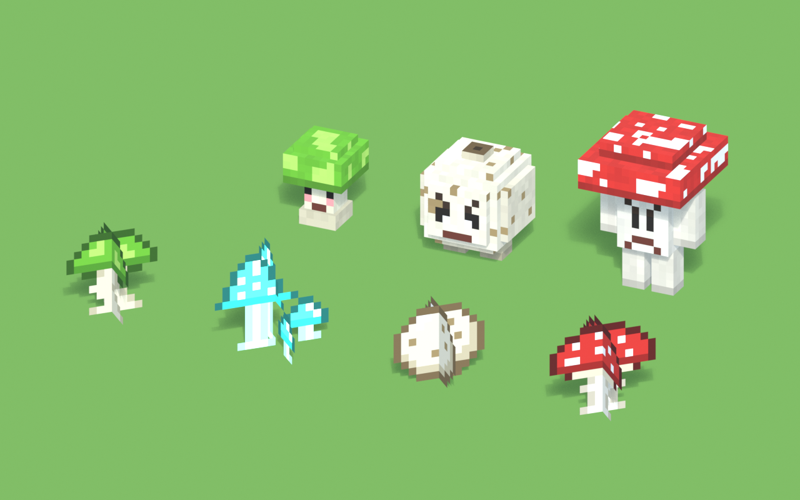
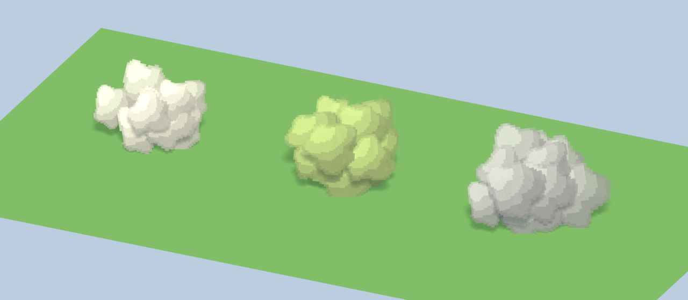

# Marov Gribs

Мод для Minecraft 1.21.1 (NeoForge) про грибы со способностями, в духе Alex Mobs.



## Что есть в версии 0.1.0

| Гриб | Где растёт | Способность блока | Если съесть |
|---|---|---|---|
| **Прыгунок** (`hopcap`) | леса, березняки, луга, грибные поля | подбрасывает того, кто наступит, гасит урон от падения (крадучись не срабатывает) | прыгучесть II, 30 с |
| **Светогриб** (`glowcap`) | пещеры по всему верхнему миру, растёт и на камне | светится (уровень 12), летят искорки | ночное зрение, 60 с |
| **Дождевик** (`puffball`) | равнины, луга, болота, тёмный лес | пыхает облаком спор: слепота и замедление II для всех, кто войдёт; перезаряжается 5 с | плавное падение, 15 с (и сытный) |
| **Мухомор** (`fly_agaric`) | тёмный лес, тайга, березняки, грибные поля | если сорвать рядом с мухоморычами, они нападут | сила II, но тошнота и яд |

Все грибы медленно расползаются сами, а от костной муки рядом вырастает ещё один.

| Моб | Где появляется | Поведение |
|---|---|---|
| **Прыгунец** (`hopling`) | леса, луга, грибные поля | мирный, передвигается прыжками, не получает урона от падения, при опасности убегает огромными скачками. Размножается прыгунками, иногда сам роняет прыгунок (как курица яйцо) |
| **Пыхтун** (`puffer`) | тёмный лес, болота, старые тайги, пышные пещеры | враждебный: подходит, раздувается и выпускает облако спор (яд + слепота), сам при этом не умирает. Если ударить его вблизи, пыхает сразу. Собственные споры на него не действуют |
| **Мухоморыч** (`agaric_guard`) | тёмный лес, старые тайги, грибные поля | нейтральный страж. Нападает, если ударить его или сорвать мухомор рядом (16 блоков); собирает на помощь всю группу. Удар отравляет |

**Облака спор.** Дождевик, пыхтун и споровая бомба выпускают пушистое облачко из крупных комочков: оно пыхает, «дышит» и через несколько секунд тает. Эффекты действуют на всё внутри облака, а не только у земли. Цвет зависит от источника: кремовое у дождевика, жёлто-зелёное ядовитое у пыхтуна, серое у бомбы.



Предметы: **Споровая бомба** (2 дождевика + нить → 2 бомбы; метается, облако ослепляет, замедляет и ослабляет) и **Похлёбка Марова** (миска + все четыре гриба: прыгучесть, ночное зрение, плавное падение и сила без отравы). Яйца призыва и вкладка «Грибы Марова» в творческом режиме. Подсказки к предметам на русском и английском.

## Запуск

```bash
./gradlew runClient
```

Клиент для разработки. Быстро посмотреть мобов: творческий мир, затем `/summon marovgribs:hopling`, `/summon marovgribs:puffer`, `/summon marovgribs:agaric_guard`.

```bash
./gradlew runGameTestServer
```

Игровые тесты (`GribTests`): батут, ловушка-дождевик, пых в ответ на удар, злость мухоморычей, костная мука, живучесть мобов.

```bash
./gradlew build
```

Готовый мод появится в `build/libs/marovgribs-0.1.0.jar`, его можно класть в папку `mods` обычной игры с NeoForge 1.21.1.

## Модели и текстуры (Blender)

Всё нарисовано скриптом [art/gribs_art.py](art/gribs_art.py) в Blender, сцена лежит в [art/marovgribs.blend](art/marovgribs.blend).

Поправить модель руками:

1. Открой `art/marovgribs.blend`. Каждый моб — пустышка-корень, под ней пустышки-кости (`hopling:cap` и т. п., точка пустышки — шарнир), под костями кубы.
2. Двигай и масштабируй кубы, двигай и вращай кости. Цвета и раскраска — в Object Properties → Custom Properties (`col`, `col2`, `paint`, `face`).
3. Сохрани и экспортируй:

```bash
blender -b art/marovgribs.blend --python art/gribs_art.py -- export
```

Экспорт сам раскладывает развёртку, рисует текстуры мобов, пишет Java-классы геометрии в `client/model/geo` и обновляет превью в `art/previews`. Классы в `geo` руками не правь: они перезаписываются. Анимации живут отдельно, в `client/model/*Model.java`.

Пересобрать сцену с нуля из описаний в скрипте (затрёт ручные правки в `.blend`):

```bash
blender -b --factory-startup --python art/gribs_art.py -- build
```

Спрайты грибов 16×16 тоже описаны в скрипте (словарь `SPRITES`, по символу на пиксель).

## Как добавить новый гриб

1. Спрайт в `SPRITES` (и, если нужен моб, описание в `MOBS`) в `art/gribs_art.py`, затем экспорт.
2. Блок в `registry/ModBlocks.java` (класс-наследник `GribBlock` со своей способностью), предмет с едой в `registry/ModItems.java`.
3. Ресурсы: blockstate, модели блока и предмета, строки в `lang/ru_ru.json` и `lang/en_us.json` (ключ `.desc` для подсказки), лут, генерация в `data/marovgribs/worldgen` и `neoforge/biome_modifier`.
4. Тест в `gametest/GribTests.java`.
